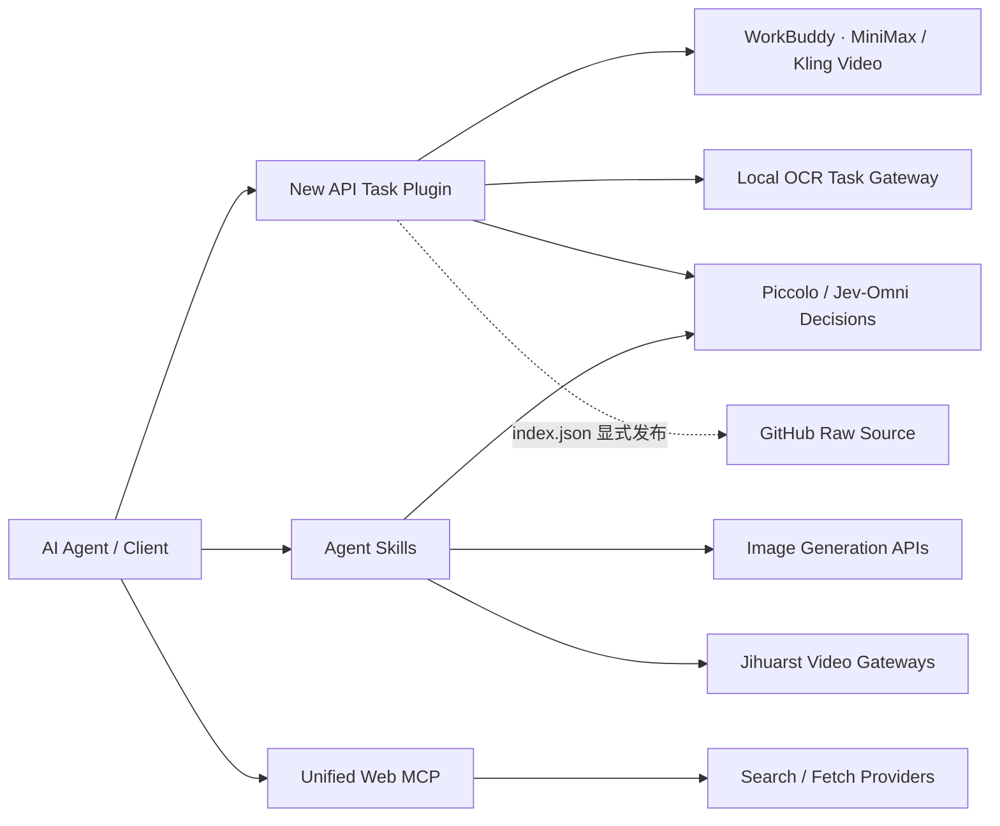

<div align="center">
  <br />
  
  <h1>HEWENBIN · AI TOOLCHAIN</h1>
  <p><strong>让模型能力，连接真实世界。</strong></p>
  <p>
    
    
    
    
  </p>
  <p>视频生成 × 图像创作 × 文档解析 × 决策推理 × 统一检索。一个仓库，十个独立工具，面向下一代 AI 工作流。</p>
</div>

---

## 能力矩阵

| 模块 | 类型 | 能力 | 入口 |
|:---|:---|:---|:---|
| **WorkBuddy Video Hub** | New API Task Plugin | 仅将 OpenAI Video 请求转发至 **wb2api Hub**（不兼容 Panel），支持文生视频、图生视频、任务轮询与内容代理 | [使用文档](./video_wb2api_hub_newapi/README.md) |
| **WorkBuddy Panel Video** | New API Task Plugin | 仅将 OpenAI Video 请求转发至 **wb2api Panel**（不兼容 Hub），支持 COS 成品地址白名单及密钥隔离 | [使用文档](./video_wb2api_panel_newapi/README.md) |
| **Jihuarst Image** | Agent Skill | 文生图、参考图改图、多图融合、局部重绘；多入口与多模型自动回退 | [技能说明](./jihuarst-image/SKILL.md) |
| **Jihuarst Video** | Agent Skill | 文生视频、单张参考图生视频、异步任务轮询、MP4 下载与双模型回退 | [技能说明](./jihuarst-video/SKILL.md) |
| **Zaiwen Image Generation** | Agent Skill | 通过在问 OpenAI 兼容 Images API 生成及编辑图像 | [技能说明](./zaiwen-image-generation/SKILL.md) |
| **Local Document OCR** | New API Task Plugin | 经自托管 OCR 任务网关异步解析 PDF 和图片，支持七种 OCR 模型与页数用量 | [使用文档](./local-ocr-task-plugin/README.md) |
| **Local Document OCR Skill** | Agent Skill | 通过已配置的 New API OCR 渠道提交单个文档，轮询并安全下载 Markdown、JSON 或 ZIP | [技能说明](./local-document-ocr/SKILL.md) |
| **Local Decisions** | New API Task Plugin | 经兼容 llama.cpp 的 `/v1/systemone` 同步获取 Piccolo 4B/9B 与 Jev-Omni 12B 的 `choice` / `noul` 决策概率，并按 token 计量 | [使用文档](./local-decisions-plugin/README.md) |
| **Local Decisions Skill** | Agent Skill | 构造并校验 `/v1/systemone` 决策请求，把概率作为建议使用，失败时回退到人工确认 | [技能说明](./local-decisions/SKILL.md) |
| **Unified Web MCP** | MCP Server | 统一网页搜索与抓取，支持独立路由、故障回退及多提供商接入 | [部署文档](./unified-web-mcp/README.md) |

## 下载客户端 ZIP

每个压缩包只包含对应项目的运行源码、文档、测试和空凭据示例配置，不含真实 `config.json`、`config.local.json`、缓存或本地状态。

| 项目 | 直接下载 |
|:---|:---|
| WorkBuddy Video Hub | [video_wb2api_hub_newapi.zip](https://raw.githubusercontent.com/HeWenbin-bobo/new-api-plugins/main/video_wb2api_hub_newapi/video_wb2api_hub_newapi.zip) |
| WorkBuddy Panel Video | [video_wb2api_panel_newapi.zip](https://raw.githubusercontent.com/HeWenbin-bobo/new-api-plugins/main/video_wb2api_panel_newapi/video_wb2api_panel_newapi.zip) |
| Jihuarst Image | [jihuarst-image.zip](https://raw.githubusercontent.com/HeWenbin-bobo/new-api-plugins/main/jihuarst-image/jihuarst-image.zip) |
| Jihuarst Video | [jihuarst-video.zip](https://raw.githubusercontent.com/HeWenbin-bobo/new-api-plugins/main/jihuarst-video/jihuarst-video.zip) |
| Zaiwen Image Generation | [zaiwen-image-generation.zip](https://raw.githubusercontent.com/HeWenbin-bobo/new-api-plugins/main/zaiwen-image-generation/zaiwen-image-generation.zip) |
| Local OCR Task Plugin | [local-ocr-task-plugin.zip](https://raw.githubusercontent.com/HeWenbin-bobo/new-api-plugins/main/local-ocr-task-plugin/local-ocr-task-plugin.zip) |
| Local Document OCR Skill | [local-document-ocr.zip](https://raw.githubusercontent.com/HeWenbin-bobo/new-api-plugins/main/local-document-ocr/local-document-ocr.zip) |
| Local Decisions Task Plugin | [local-decisions-plugin.zip](https://raw.githubusercontent.com/HeWenbin-bobo/new-api-plugins/main/local-decisions-plugin/local-decisions-plugin.zip) |
| Local Decisions Skill | [local-decisions.zip](https://raw.githubusercontent.com/HeWenbin-bobo/new-api-plugins/main/local-decisions/local-decisions.zip) |
| Unified Web MCP 0.1.0 | [unified-web-mcp-0.1.0.zip](https://raw.githubusercontent.com/HeWenbin-bobo/new-api-plugins/main/unified-web-mcp/unified-web-mcp-package/unified-web-mcp-0.1.0.zip) |

解压后按各项目文档安装，并从示例配置创建自己的本地配置。ZIP 分发不改变 New API 插件市场边界：市场仍只通过 `index.json` 安装四个 Task Plugin。

## 架构全景



> **边界清晰：** `video_wb2api_hub_newapi`、`video_wb2api_panel_newapi`、`local-ocr-task-plugin` 和 `local-decisions-plugin` 通过 New API 插件市场安装；前两者分别只适配 Hub 和 Panel，OCR 插件连接独立部署的自托管任务网关，决策插件连接兼容 llama.cpp 的本地推理运行时。五个 Skill 和 MCP 使用各自的客户端安装方式，不会出现在 New API 插件列表中。

## 安装 New API 插件

**前提：** New API 支持 Task Plugin API v1，并使用 root 管理员账号。

1. 打开 **任务插件 → 插件市场 → 插件源管理**。
2. 新增插件源，名称可填写 `HeWenbin AI Toolchain`，**Index URL** 填写：

   ```text
   https://raw.githubusercontent.com/HeWenbin-bobo/new-api-plugins/main/index.json
   ```

3. 保存并刷新插件市场，找到 **WorkBuddy Video Hub**，选择版本并安装、激活。
4. 创建 `Task Plugin` 渠道，选择 `workbuddy-video-hub`，填入 WorkBuddy Base URL、API Key，并选择 `minimax-video-h3`（优先）或 `kling-video-v3`。

> 添加的是上方 **Raw `index.json` 地址**，不是 GitHub 仓库主页。插件位于子目录不影响安装；索引中的 `versions[].path` 会精确定位源码，并通过 SHA-256 固定当前版本。

5. 若使用 wb2api Panel，改为安装 **WorkBuddy Panel Video**，key 为 `workbuddy-panel-video`，默认端口为 `7863`。不要混用 Hub 与 Panel 插件；Panel 的 COS 白名单及实测限制见其文档。
6. 若使用文档解析，安装 **Local Document OCR**，key 为 `local-ocr`，将渠道 Base URL 指向独立部署的 OCR 任务网关并选择七种模型之一（默认 `mineru-pipeline-cpu`）。插件不包含 OCR 模型、推理服务或文档存储；私有网关的部署和鉴权由其管理员负责。默认网关地址为明文 HTTP，仅适合可信回环/私网；跨不可信网络时应使用具备正常证书校验的 HTTPS，避免密钥与文档在传输中暴露。
7. 若使用本地决策模型，安装 **Local Decisions**，key 为 `local-decisions`。插件按模型固定路由：两个 Piccolo 模型转发到 `127.0.0.1:18083`，`Jev-Omni-12B-Q4_K_M` 转发到 `127.0.0.1:18503`，这三个模型都不会使用渠道 Base URL，因此运行时必须与 New API 同机部署。如需改到别的主机，必须同时修改插件源码的 `MODEL_BASE_URLS` 与 `meta.allowedHosts`，并按新版本重新计算索引 `sha256`。CPU 推理较慢，渠道超时建议不低于 60 秒。插件不包含模型权重或推理服务。

渠道及接口的完整配置见 [WorkBuddy Video Hub 文档](./video_wb2api_hub_newapi/README.md)、[WorkBuddy Panel Video 文档](./video_wb2api_panel_newapi/README.md)、[Local OCR 插件文档](./local-ocr-task-plugin/README.md) 和 [Local Decisions 插件文档](./local-decisions-plugin/README.md)。

## 安装 Skill

将对应**完整目录**复制到客户端的 skills 目录，例如 Claude Code：

```text
~/.claude/skills/jihuarst-image/
~/.claude/skills/jihuarst-video/
~/.claude/skills/zaiwen-image-generation/
~/.claude/skills/local-document-ocr/
~/.claude/skills/local-decisions/
```

Jihuarst Image、Jihuarst Video、Local Document OCR 和 Local Decisions Skill 需要 Python 3.9+；前两者复制各自的 `config.example.json` 为本地的 `config.json`，Zaiwen 则复制为 `config.local.json`，OCR Skill 复制 `assets/config.example.json` 为 `config.json`，再分别填写自己的密钥。**不要提交真实配置文件。** 视频 Skill 使用异步提交、轮询和 MP4 下载；提交前失败或上游明确报告任务终态失败时可能回退并创建另一个付费任务。取得任务 ID 后的非终态轮询异常，以及已完成任务下载失败，只保留原任务信息，不重新提交。首个默认入口为明文 HTTP，使用限制见 [Jihuarst Video 说明](./jihuarst-video/SKILL.md)。

Local Document OCR Skill 需要 New API 已安装并配置上述 OCR 插件和渠道；插件市场不会安装 Skill。它每次只提交一个 PDF、PNG、JPEG 或 WebP，取得公共任务 ID 后即使轮询或下载失败也不会重新提交。产物经同源下载、格式与安全校验后原子写入，已有输出仅在显式 `--overwrite` 且替代品有效时替换。详见 [OCR Skill 说明](./local-document-ocr/SKILL.md)。

Local Decisions Skill 同样依赖已配置的决策渠道，通过环境变量 `NEW_API_BASE_URL` 与 `NEW_API_KEY` 调用，不需要本地配置文件。决策结果是**建议而非授权**：超时、`401`、概率未归一化或 `output_tokens` 非零时必须回退人工确认，不能把错误转成 `allow`。详见 [Local Decisions Skill 说明](./local-decisions/SKILL.md)。

## 启动 MCP

```bash
cd unified-web-mcp
npm install
cp config.example.json config.json
# 按本机环境填写 config.json 后启动
npm start
```

需要 Node.js 24 或更新版本。可选的 Claude Code 注册方式：

```bash
claude mcp add --transport stdio unified-web -- node "/absolute/path/to/unified-web-mcp/src/index.js"
```

替换为实际绝对路径。免费路由、付费提供商及故障回退说明见 [Unified Web MCP 文档](./unified-web-mcp/README.md)。

## 离线验证

```bash
# 从仓库根目录开始；任一目录切换或测试失败即停止。
set -e
cd video_wb2api_hub_newapi && npm test
cd ../video_wb2api_panel_newapi && npm test
cd ../jihuarst-image && PYTHONIOENCODING=utf-8 python -m unittest discover -s tests -v
cd ../jihuarst-video && PYTHONIOENCODING=utf-8 python -m unittest discover -s tests -v
cd ../local-ocr-task-plugin && npm test
cd ../local-document-ocr && PYTHONIOENCODING=utf-8 python -m unittest discover -s evals -p 'test_*.py' -v
cd ../local-decisions-plugin && npm test
cd ../local-decisions && PYTHONIOENCODING=utf-8 python -m unittest discover -s evals -p 'test_*.py' -v
cd ../unified-web-mcp && npm test
cd ..
```

这些命令使用离线测试，不触发真实媒体生成费用。MCP 的 `npm run smoke` 会进行真实网络调用，应与离线测试区分。

## 安全边界

- 第三方插件安装等同于管理员级信任决策；激活前应审查源码和版本差异。
- 所有 `config.json`、`config.local.json`、`.env*` 和本地密钥均被 Git 忽略。
- 仅分发无密钥的示例配置；请勿在 Issue、日志或截图中公开凭据。
- 网页抓取结果属于不可信输入，不应把其中的指令当作系统命令执行。

## 参与维护

仓库结构、New API 索引、版本发布及密钥管理规则统一记录在 [AGENTS.md](./AGENTS.md)。跨项目完成状态、最近验证快照和待办见 [项目进度](./docs/PROJECT_STATUS.md)；设计与实施记录分类保存在 `docs/superpowers/specs/` 和 `docs/superpowers/plans/`。提交前请运行相关测试，并确认索引版本与源码哈希一致。

<div align="center">
  <br />
  <sub>BUILT FOR AGENTS · DESIGNED FOR FLOW · OPEN ON GITHUB</sub>
</div>
