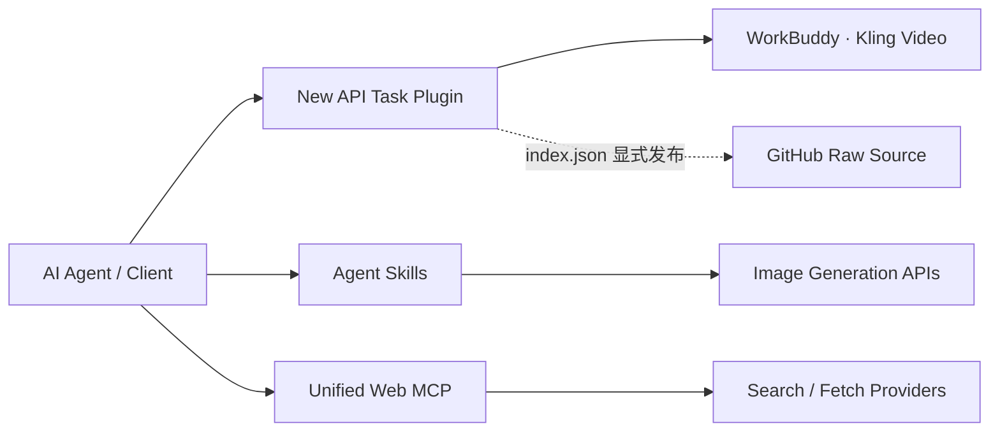

<div align="center">
  <br />
  
  <h1>HEWENBIN · AI TOOLCHAIN</h1>
  <p><strong>让模型能力，连接真实世界。</strong></p>
  <p>
    
    
    
    
  </p>
  <p>视频生成 × 图像创作 × 统一检索。一个仓库，四种能力，面向下一代 AI 工作流。</p>
</div>

---

## 能力矩阵

| 模块 | 类型 | 能力 | 入口 |
|:---|:---|:---|:---|
| **WorkBuddy Kling** | New API Task Plugin | 将 OpenAI Video 请求转发至 WorkBuddy，支持文生视频、图生视频、任务轮询与内容代理 | [使用文档](./kling_wb2api_newapi/README.md) |
| **Jihuarst Image** | Agent Skill | 文生图、参考图改图、多图融合、局部重绘；多入口与多模型自动回退 | [技能说明](./jihuarst-image/SKILL.md) |
| **Zaiwen Image Generation** | Agent Skill | 通过在问 OpenAI 兼容 Images API 生成及编辑图像 | [技能说明](./zaiwen-image-generation/SKILL.md) |
| **Unified Web MCP** | MCP Server | 统一网页搜索与抓取，支持独立路由、故障回退及多提供商接入 | [部署文档](./unified-web-mcp/README.md) |

## 架构全景



> **边界清晰：** `kling_wb2api_newapi` 通过 New API 插件市场安装；两个 Skill 和 MCP 使用各自的客户端安装方式，不会出现在 New API 插件列表中。

## 安装 New API 插件

**前提：** New API 支持 Task Plugin API v1，并使用 root 管理员账号。

1. 打开 **任务插件 → 插件市场 → 插件源管理**。
2. 新增插件源，名称可填写 `HeWenbin AI Toolchain`，**Index URL** 填写：

   ```text
   https://raw.githubusercontent.com/HeWenbin-bobo/new-api-plugins/main/index.json
   ```

3. 保存并刷新插件市场，找到 **WorkBuddy Kling**，选择版本并安装、激活。
4. 创建 `Task Plugin` 渠道，选择 `workbuddy-kling`，填入 WorkBuddy Base URL、API Key 与模型 `kling-video-v3`。

> 添加的是上方 **Raw `index.json` 地址**，不是 GitHub 仓库主页。插件位于子目录不影响安装；索引中的 `versions[].path` 会精确定位源码，并通过 SHA-256 固定当前版本。

渠道及接口的完整配置见 [WorkBuddy Kling 文档](./kling_wb2api_newapi/README.md)。

## 安装 Skill

将对应**完整目录**复制到客户端的 skills 目录，例如 Claude Code：

```text
~/.claude/skills/jihuarst-image/
~/.claude/skills/zaiwen-image-generation/
```

Jihuarst Image 需要 Python 3.9+；复制其 `config.example.json` 为本地的 `config.json`，Zaiwen 则复制为 `config.local.json`，再分别填写自己的密钥。**不要提交真实配置文件。** 详细运行约束见各技能的 `SKILL.md`。

## 启动 MCP

```bash
cd unified-web-mcp
npm install
cp config.example.json config.json
# 按本机环境填写 config.json 后启动
npm start
```

需要 Node.js 24 或更新版本。可选的 Claude Code 注册方式：

```bash
claude mcp add --transport stdio unified-web -- node "/absolute/path/to/unified-web-mcp/src/index.js"
```

替换为实际绝对路径。免费路由、付费提供商及故障回退说明见 [Unified Web MCP 文档](./unified-web-mcp/README.md)。

## 离线验证

```bash
# New API 插件
cd kling_wb2api_newapi && npm test

# Jihuarst Skill
cd jihuarst-image && python -m unittest discover -s tests -v

# Unified Web MCP
cd unified-web-mcp && npm test
```

这些命令使用离线测试，不触发真实媒体生成费用。MCP 的 `npm run smoke` 会进行真实网络调用，应与离线测试区分。

## 安全边界

- 第三方插件安装等同于管理员级信任决策；激活前应审查源码和版本差异。
- 所有 `config.json`、`config.local.json`、`.env*` 和本地密钥均被 Git 忽略。
- 仅分发无密钥的示例配置；请勿在 Issue、日志或截图中公开凭据。
- 网页抓取结果属于不可信输入，不应把其中的指令当作系统命令执行。

## 参与维护

仓库结构、New API 索引、版本发布及密钥管理规则统一记录在 [AGENTS.md](./AGENTS.md)。提交前请运行相关测试，并确认索引版本与源码哈希一致。

<div align="center">
  <br />
  <sub>BUILT FOR AGENTS · DESIGNED FOR FLOW · OPEN ON GITHUB</sub>
</div>
